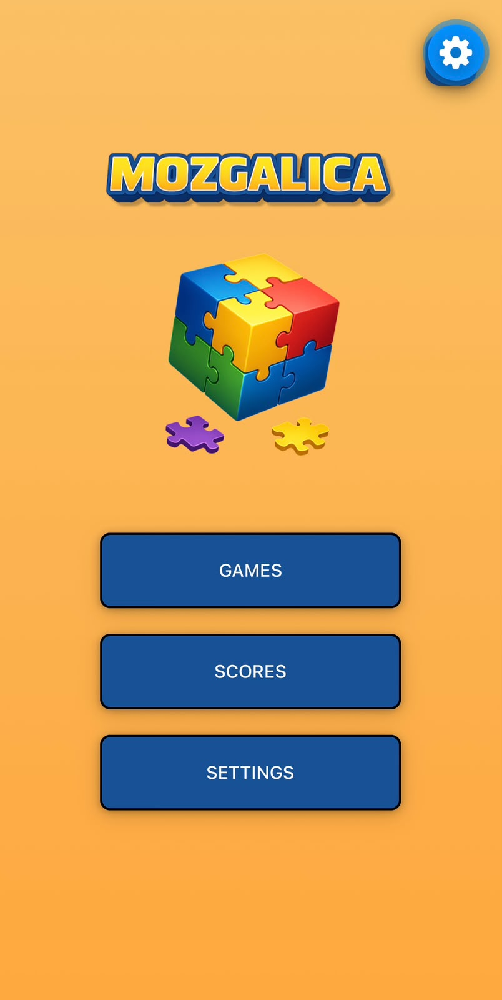
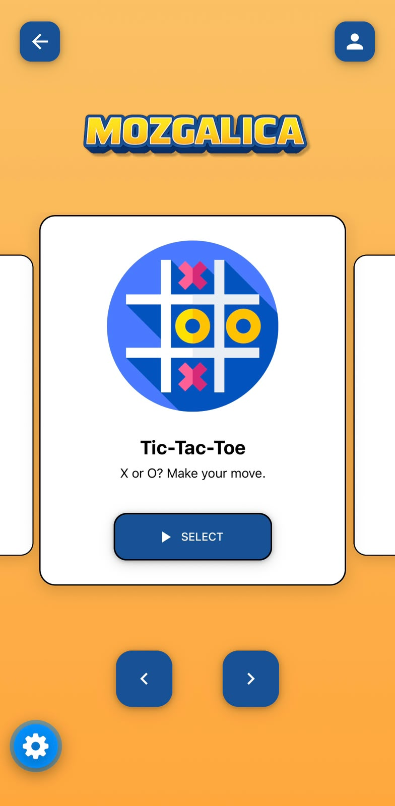
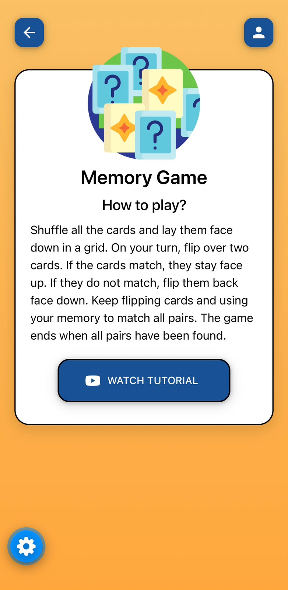
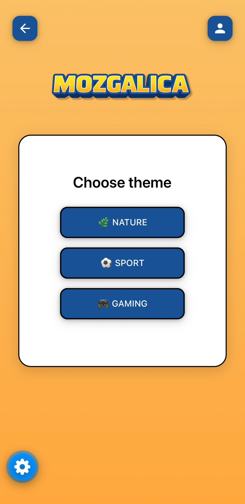
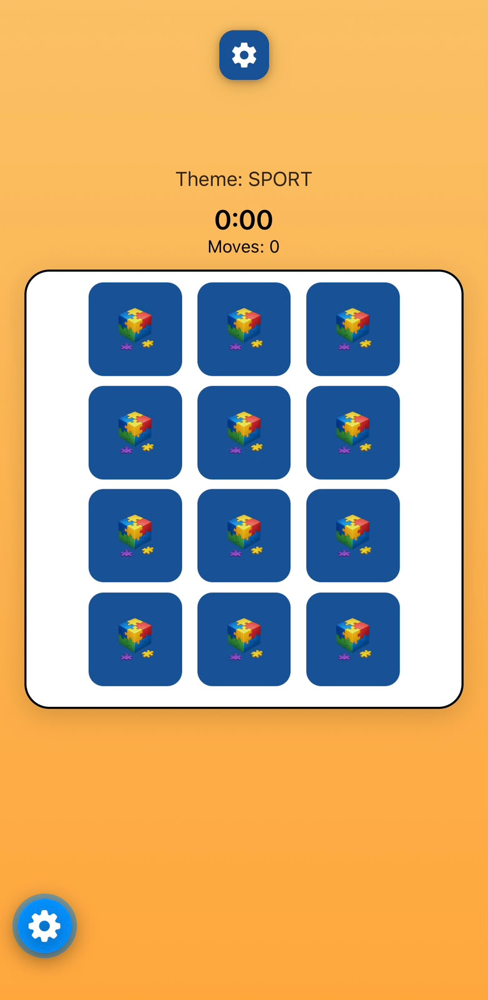
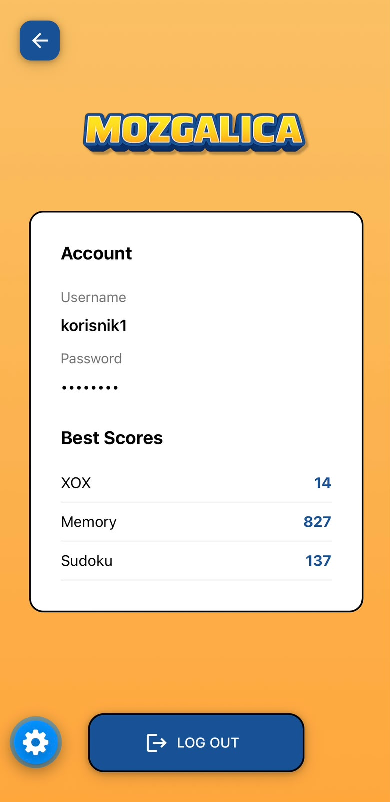
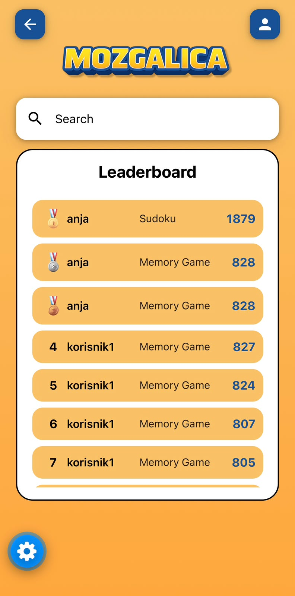
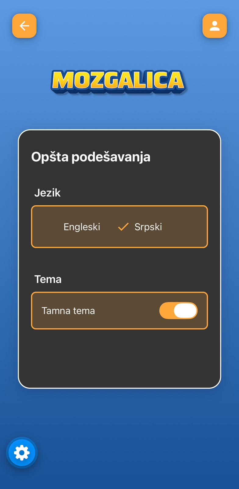

# Mozgalica

**Mozgalica** je mobilna aplikacija razvijena korištenjem tehnologije React Native, koja objedinjuje više logičkih igara u jedinstvenu aplikaciju. Korisnicima omogućava igranje različitih igara kao što su XOX, igra memorije i sudoku, kao i praćenje ostvarenih rezultata i pregled istorije rezultata svih korisnika.

Aplikacija je razvijena s ciljem pružanja jednostavnog i intuitivnog korisničkog iskustva, uz minimalistički dizajn, preglednu navigaciju i podršku za srpski i engleski jezik.

## Funkcionalnosti

- **Logičke igre** – zbirka različitih igara koje podstiču logičko razmišljanje, koncentraciju i pamćenje.
- **Rezultati i istorija** – čuvanje rezultata odigranih igara u lokalnoj SQLite bazi podataka.
- **Korisnički identitet** – učešće u igrama pod jedinstvenim korisničkim imenom.
- **Pregled rezultata** – prikaz istorije rezultata svih korisnika, uz mogućnost pretrage i filtriranja prema različitim kriterijumima.
- **Detalji igara** – prikaz opisa, pravila i načina bodovanja za svaku igru, uz dodatne sadržaje.
- **Višejezičnost** – podrška za srpski i engleski jezik, uz mogućnost promjene jezika u podešavanjima.
- **Korisnički interfejs** – minimalistički dizajn, intuitivna navigacija i prilagođavanje različitim dimenzijama ekrana.

## Tehnologije

- **React Native** – razvoj mobilne aplikacije.
- **TypeScript / JavaScript** – implementacija aplikacione logike i korisničkog interfejsa.
- **SQLite** – lokalno skladištenje rezultata.
- **i18next / react-i18next** – implementacija višejezičnosti.
- **React Navigation** – navigacija između ekrana aplikacije.
- **React Native Paper** – komponente korisničkog interfejsa.
- **React Native Reanimated** – realizacija animacija i tranzicija.
- **Expo** – razvojno okruženje i alati za pokretanje aplikacije.

## Struktura aplikacije

Aplikacija je organizovana kroz nekoliko funkcionalnih cjelina:

- Početni ekran – prikaz dostupnih igara i navigacija kroz aplikaciju.
- Igre – zasebni ekrani i logika za svaku implementiranu igru.
- Istorija rezultata – pregled i pretraga sačuvanih rezultata.
- Detalji igara – informacije o pravilima i bodovanju.
- Podešavanja – izbor jezika i upravljanje korisničkim postavkama.

## Pokretanje projekta

Za lokalno pokretanje projekta potrebno je imati instalirane Node.js i npm.

1. Klonirati repozitorijum:

   ```bash
   git clone https://github.com/anjavr/games-mobile-app.git
   ```

2. Pozicionirati se u direktorijum projekta:

   ```bash
   cd games-mobile-app
   ```

3. Instalirati zavisnosti:

   ```bash
   npm install
   ```

4. Pokrenuti razvojni server:

   ```bash
   npx expo start
   ```

5. Otvoriti aplikaciju pomoću Expo Go aplikacije ili odgovarajućeg emulatora.

## Razvoj

Projekat je razvijen kao studentski projekat u okviru predmeta Mobilno računarstvo. 

## Izgled aplikacije

### Početni ekran



### Izbor igre



### Opis igre


### Pravila igre



### Levels igre memorija



### Igranje igre memorija



### Korisnička podešavanja



### Rang lista



### Tema i jezik


